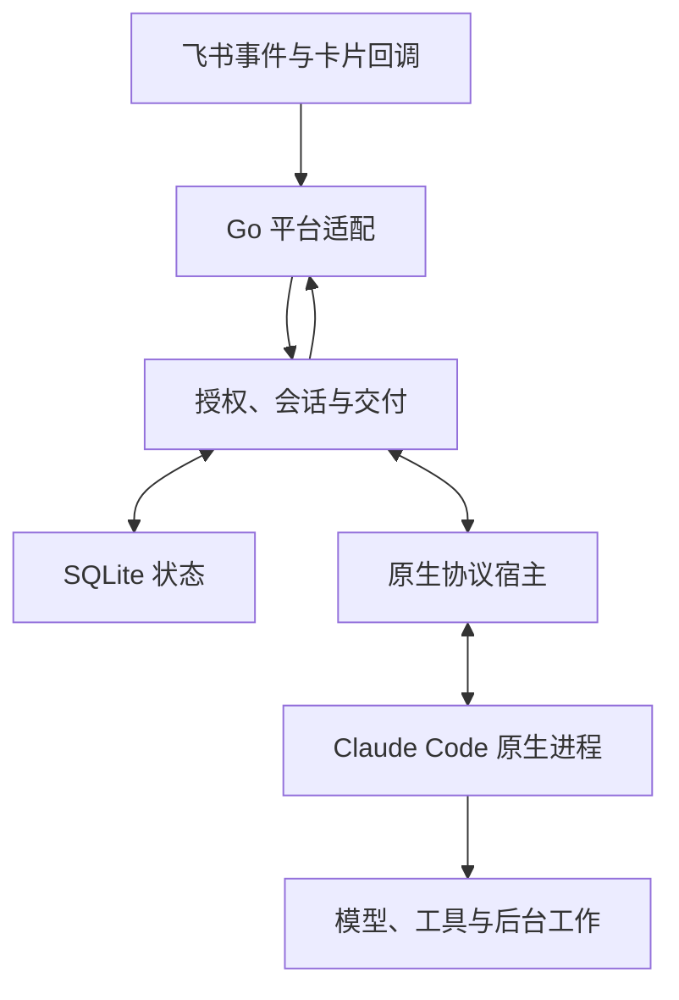

# 架构

Go 服务负责平台连接、权限、持久交付和原生进程生命周期。Claude Code 负责模型循环、工具、子代理、上下文与后台工作。网关不增加第二个 planner、压缩器或业务调度器。

## 模块边界

| 模块 | 职责 |
|---|---|
| `internal/core` | 可替换的 Transport、WorkerFactory 和稳定的持久 JSON 类型 |
| `internal/config` | 配置默认值、严格校验、模型头与凭据引用 |
| `internal/store` | SQLite schema 5、收件／会话、恢复与保留策略 |
| `internal/workspace` | 稳定工作目录、原生配置身份、安全文件快照与独占锁 |
| `internal/feishu` | REST、长连接、原始内容解析、CardKit 和本应用表情 |
| `internal/native` | 双向 stream-json、初始化、MCP、权限／hooks、输入归属和进程树 |
| `internal/gateway` | 聊天授权、调度、审批、历史、图片批次、回复与 outbox |
| `internal/cli` | init／doctor／run、信号、恢复和有序关闭 |

生产路径不加载 Node.js 或 TypeScript Agent SDK。Go 原生宿主直接实现 CLI 的双向控制协议；协议兼容性由固定 Claude 版本的真实进程回归验证，不能仅靠结构体编译成功来证明。飞书长连接使用官方 Go SDK 的公开 protobuf 帧定义，连接生命周期由可取消的 Go 适配层管理。

## 会话、输入和容量

房间键继续包含 tenant、app、project、聊天类型、chat ID 和私聊用户 ID，不包含线程。项目是资源／权限配置单元，不必是代码仓库。首次任务准备工作区并启动 Claude，热会话复用同一原生进程；不再增加每会话一个 Node 宿主。

群输入同时要求群、作者和明确 @；私聊只免除 @。拒绝在保存正文、下载、回执和模型调用之前完成。授权检查复用于恢复、历史、引用、附件、审批和输出重试。

每条输入保留独立 UUID、消息 ID、作者和线程信息。状态从 queued 到 sent、consumed、done，另有 cancelled 和 uncertain；管道写入不等于模型已读。原生消费和结果归属决定哪些输入可以完成，后台结果不默认挂到最新提问。SQLite 插入顺序保护 compact 控制边界。

普通忙时输入交给既有流。`/btw`／`/ps` 绑定当前前台原输入；网关和原生宿主都检查目标是否仍存在，目标结束后不能将补充转成新任务。`/compact` 在轮次结束后使用原生命令，等待期间审批仍可操作。`/stop` 保留会话，只有 `/new` 新建；无效 resume 不自动回退新会话。

`maxWorkers` 限制活跃原生会话。已确认空闲、没有待交付输入、后台工作、审批、输出或未知状态的进程才可回收。停止无法确认时保留原名额和服务锁，避免另一个实例重复接管。

## 上下文与文件

非 @ 背景消息默认不缓存。历史工具一次读取一页，校验当前聊天、作者、时间、数量及带签名的会话游标；附件仅使用已授权消息的有限资源元数据。合并转发不自动展开，不递归读取其他聊天。

连续独立图片合批默认关闭。开启后仅合并同聊天、同作者、同会话且引用／线程一致的相邻图片。批次截止时间和限制随每条原消息持久化，定时器只唤醒派发。下载、单文件或总量检查失败时整批取消；每条原始消息的 UUID 和回执都保留。

附件下载和导出使用有界流式复制。导出快照通过受限目录句柄读取，防止检查后替换符号链接逃逸；审批绑定冻结后的文件字节。共享系统账户仍然不是租户安全沙箱。

## 回复与外部写入

原生内容按消息／块 ID 对齐增量和完整快照，只展示公开 text／thinking。签名、redacted thinking 和工具轨迹不展示。思考与答案在同一卡片更新，最终折叠思考；原始输入归属随结果和 outbox 保存。

最终结果先持久化再执行网络写入。已知消息 ID 的更新可以重试；卡片创建、消息发送或文件上传结果未知时保留 uncertain，等待用户明确核对／补发，不能无条件重发。长答案的摘要卡和完整文件共同组成交付，必要文件未确认时不得添加 Done。

CardKit ID、序号和确认快照保存在旧表中，重启继续更新原卡。只有确定的权限拒绝才回退同卡整卡更新，网络超时不变成再发一张卡。回执只管理本应用的表情，完成必须晚于全部必要输出。

原生权限和追问通过独立控制通道往返，外部写操作由获准维护者确认。回调同时检查请求、会话、聊天、卡片和操作者；停止、重启或过期后不能重新激活旧请求。

## 并发、取消和关闭

每聊天入站锁保护本地接收和控制顺序，不跨网络等待。原生输出、回复预览、持久交付和表情各自串行化必要状态，其他聊天可以并行。数据库单连接保持事务顺序，事务内不执行网络请求或再次调用 Store。

取消先停止事件准入，再取消原生与网络等待，最后确认进程、关闭数据库并释放锁。迟到网络结果不再写已关闭的数据库。不确定的新写入和已知 ID 更新分别保存，取消本地等待不代表远端操作已被撤销，也不提供 exactly-once 保证。

Linux 使用原生进程组终止；Windows 使用进程作业对象与平台终止机制。继承的插件、MCP 或脱离进程树的外部服务需要单独管理；会话历史保存不代表旧后台进程可恢复。

## 依赖与参考

- [飞书官方 Go SDK](https://github.com/larksuite/oapi-sdk-go)：公开长连接帧类型。
- [Claude Agent SDK](https://github.com/anthropics/claude-agent-sdk-typescript)：旧版协议行为和固定 CLI fixture 的参照；不作为 Go 生产依赖。
- [Go SQLite](https://pkg.go.dev/modernc.org/sqlite)：无 CGO SQLite 驱动。
- [对话规则](conversation-contract.md)、[迁移](go-migration.md)和[验证](validation.md)。
