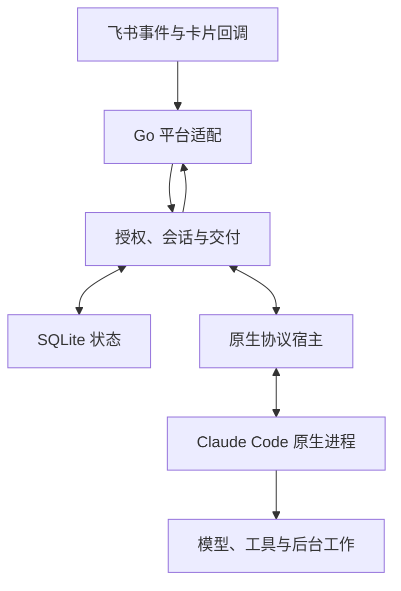

# 架构

本页是模块边界、进程／会话模型和并发规则的当前契约。用户可见的授权、会话命令、补充、compact 和交付行为见[对话行为](conversation-contract.md)；配置项、默认值和运维步骤见[部署与配置](deployment.md)。

Go 网关负责平台连接、授权、会话路由、持久交付和原生进程生命周期。Claude Code 负责模型循环、工具、子代理、上下文与后台工作。网关不增加第二个 planner、压缩器或业务调度器。

## 模块边界

| 模块 | 职责 |
|---|---|
| `internal/core` | 可替换的 Transport、WorkerFactory、房间键和稳定的持久 JSON 类型 |
| `internal/config` | 配置默认值、严格校验、模型头与凭据引用 |
| `internal/store` | SQLite schema 5：收件／会话、原生身份未决、停止暂停、待补存用量、话题根消息交付、本地会话认领、恢复与保留策略 |
| `internal/workspace` | 稳定工作目录、原生配置身份、附件目录与迁移、安全文件快照与独占锁 |
| `internal/feishu` | REST、长连接、原始内容解析、卡片回调截止、CardKit 和本应用表情 |
| `internal/native` | 双向 stream-json、初始化、MCP、权限／hooks、会话显示名、输入归属和进程树 |
| `internal/process` | 原生会话、固定操作和诊断共用的进程组／Job Object 所有权、终止确认与进程树 RSS 采样 |
| `internal/gateway` | 聊天授权、调度与容量准入、审批、历史、附件、图片批次、回复、outbox 与用量记账 |
| `internal/cli` | init／doctor／run／daemon、信号、恢复和有序关闭 |

生产路径不加载 Node.js 或 TypeScript Agent SDK。Go 原生宿主直接实现 CLI 的双向控制协议；协议兼容性由固定 Claude 版本的真实进程回归验证（见[验证与验收](validation.md)），不能仅靠结构体编译成功来证明。飞书长连接使用官方 Go SDK 的公开 protobuf 帧定义，连接生命周期由可取消的 Go 适配层管理。同聊天消息进入稳定的有界队列，回调另有独立队列；队列及处理 context 属于整个服务生命周期，短暂重连不取消已接收的处理或丢弃队列，也不等待慢处理才建立新连接。ACK 始终属于接收该事件的旧 socket，晚到 ACK 失败不能关闭新连接；服务停止时统一取消处理并等待退出。

## 房间、会话与输入

[房间键](terminology.md)由 tenant、app、project、聊天类型、chat ID 和私聊用户 ID 组成，整群范围不包含线程；`sessionScope: "thread"` 的群在同样字段后追加话题根消息 ID，每个话题独立排队、执行和恢复，默认共用该群的工作目录。`threadWorkspaces` 只覆盖指定话题的原生 cwd，房间键、聊天级状态和原生 HOME 的布局不变，附件仍按话题分开；网关启动与本地终端交接均核对已有 `session_launch_identity`，不会把历史会话悄悄搬到新目录（见[话题会话](conversation-contract.md#话题会话)）。项目是资源／权限配置单元，不必是代码仓库。首次任务准备工作区并启动 Claude，热进程在后续消息中复用；没有每会话一个的 Node 宿主。

本地认领话题使用同样字段后追加根消息 ID 的七段**私聊**键。`adopted_topics` 保存 room、session、native ID、thread ID、根消息、登记 cwd、终端 holder 与 `pending|open|uncertain` 状态；房间的 `WorkspaceCWD` 只从该记录补全，并在每次解析时重新校验 adoptRoots。入站、恢复、outbox、卡片回调、历史读取和 `session run` 都经过同一个 adopted-aware 解析 helper；键形状合法但没有记录、记录不是 open 或工作目录失效时拒绝，不把七段键当作普通私聊。认领的本地控制通道沿用数据目录下的请求文件（临时文件 + rename），结果写回同一目录，不引入 socket 或命名管道；网关启动、本地终端交接和认领共用同一条原生会话身份与启动身份核对路径。

任务通知复用 `adopted_topics` 和同一控制通道：`notify` 首次创建话题、之后追加回复；`topic reply` 把本地会话的答案写回话题。终端仍存活时，网关把 owner 的普通话题消息通过 CC 原生跨会话收件箱转递给 holder 进程，转递输入使用独立的 `forwarded` 收件状态，不进入网关的原生输入队列，也不启动第二个进程。收件箱 endpoint 只在内存中保存，token 不写 SQLite、日志或审计；holder 释放、`/new`、重新认领和重启后重新注册。未回复的转递消息标 uncertain、不重放。

授权在保存正文、下载、回执和模型调用之前完成，规则见[授权与触发](conversation-contract.md#授权与触发)。同一授权检查复用于恢复、历史、引用、附件、审批和输出重试。其他机器人的入站只由显式群 `allowOtherBots` 开启，仍要求明确 @，并受同一话题连续轮数限制；它们的内容是不可信输入，不能借 `mention_bot` 获得 action、审批或维护者身份。

每条输入保留独立 UUID、消息 ID、作者和线程信息。状态从 queued 到 sent、consumed、done，另有 cancelled 和 uncertain；管道写入不等于模型已读。原生消费和结果归属决定哪些输入可以完成，后台结果不默认挂到最新提问。SQLite 插入顺序保护 compact 控制边界。待交付额度的计数与入队在同一事务中完成，话题范围的群按整群合计，消息与卡片补充并发到达也不会突破上限。

普通忙时输入交给既有原生输入流。`/btw`／`/ps` 绑定当前前台原输入；网关和原生宿主都检查目标是否仍存在，目标结束后补充不能转成新任务。`/compact` 在轮次结束后使用原生命令，等待期间审批仍可操作。

项目可配置一个只读的[预检索上下文](terminology.md)：网关在新一轮人类输入开始时，与工作区和原生启动并行执行受控固定操作，把带出处的文本注入本轮输入 JSON；它不规划步骤、不替代原生工具、不门控输入。检索失败或超时按 fail-open 发送原输入，行为规则见[预检索上下文](conversation-contract.md#预检索上下文)。

## 原生进程生命周期

会话与进程分开管理：数据库保存房间到原生 session ID 的映射，transcript 在原生 HOME 中。服务重启、空闲回收或停止后，下一条输入用明确的 resume ID 启动新进程；无效 resume 或返回不同 ID 时保留原映射并报错，不回退到新会话。只有 `/new` 和显式恢复其他会话改变当前映射。

**原生身份未决。** 尚无原生 ID 的会话在启动进程前，先在状态库提交[原生身份未决](terminology.md)状态。原生报告 ID 后，写入 ID 与解除未决在同一事务完成；写库在短暂重试后仍失败，就在工作区写入原子替换的标记文件，下次启动先采用标记中的 ID 再续接。两种记录都失败或 ID 与已记录值冲突时，停止该运行，之后不会以空 ID 启动替代上下文，需维护者用 `/resume` 或 `/new` 明确选择。只有进程清理和事件处理均已确认、且从未交接输入也未观察到原生身份的启动（启动失败，或在首条输入前自行退出）才解除未决、允许重试。停止、空闲回收、模型配置切换和服务关闭都等待该进程最后的事件处理完毕；旧运行异步触发的停止只作用于自己那一代进程，不影响 `/new` 或恢复后选中的新运行。

**退出协调。** 原生意外退出时，已发送但无结果的输入在同一事务中标为 uncertain，不重放。该事务失败时保留退出协调状态，定期扫描在存储恢复后补做并释放队列占用；进程停止未确认时保留名额和服务锁，避免替代进程并行执行。停止意图的持久化见[停止](conversation-contract.md#停止)。

## 容量与回收

`maxWorkers` 限制全局活跃原生进程，可选的 `maxWorkersPerChat` 限制单个聊天（同群各话题共用），可选的 `maxRssMiB` 在新进程准入时检查网关及其当前后代进程的 RSS 合计。准入只作用于启动新进程；已有进程、正在流入的输入、审批和后台工作不会因额度或内存阈值被取消。参数取值见[部署与配置](deployment.md#容量与恢复)。

准入失败时，网关按最近活动时间从旧到新尝试回收确认空闲的进程（聊天额度只回收本聊天的进程），释放成功后重新检查；仍不足时输入保持排队，并对该房间提示一次等待原因。RSS 观测不可用时直接等待、不据此回收。定期维护在 RSS 超过阈值时同样回收确认空闲的进程。RSS 合计可能重复计算共享页，快照也不是原子的进程树普查，因此它是限制继续新建的信号，不是硬内存上限。

只有已确认空闲、没有待交付输入、后台工作、Monitor、审批、进行中的交付或未知原生状态的进程才可回收；停止未确认时保留名额。空闲预算默认固定为 `idleMs`；设置 `idleMinMs` 后，进程首次成功输入后的预算从该值开始，每次成功复用加倍，最多到 `idleMs`。回收只释放进程，不改 session ID、工作文件或记忆，已持久化但尚未送达的输出继续由交付队列处理。

## 上下文与文件

非 @ 背景消息默认不缓存。历史工具一次读取一页，校验当前聊天、作者、时间、数量及带签名的会话游标；附件仅使用已授权消息的有限资源元数据。话题群配置 `topicHistory: "chat"` 时可按需读取同群时间线和其他话题，其他话题内容标为背景，绝不跨群；显式配置 `dms[].historyChats` 的私聊可按白名单读取目标群，但发起人必须是目标群 maintainer 或显式 member，读取后本轮进入污染状态，写工具改为 DM 用户审批。合并转发不自动展开。行为规则见[默认不注入群背景](conversation-contract.md#默认不注入群背景)。

普通入站附件与 `fetch_attachment` 共用同一下载路径：数据先写入本次尝试独有的临时文件，确认是普通文件且不超过字节上限并同步落盘后，才以按消息和资源 key 派生的短内部名发布到附件目录；同一目标由文件锁串行化。中断或取消只清理本次临时文件，不会让未完成的文件冒充完整结果；已发布文件可直接复用，也供未发送输入恢复使用。显示文件名与磁盘名称分开保存，长中文名称不会超过文件系统名称限制。旧版本原地下载的文件不作为缓存命中。

连续独立图片合批默认关闭，持久化与派发规则见[连续图片输入](image-batches.md)。批次截止时间随每条原消息持久化，定时器只唤醒派发，不是业务调度器。

附件下载和导出使用有界流式复制。导出快照通过受限目录句柄读取，防止检查后替换符号链接逃逸；审批绑定冻结后的文件字节。共享系统账户仍然不是租户安全沙箱。

## 回复与外部写入

原生内容按消息／块 ID 对齐增量和完整快照，只展示公开 text／thinking。签名、redacted thinking 和工具轨迹不展示。思考与答案在同一卡片更新，原始输入归属随结果和 outbox 保存。

最终结果先持久化再执行网络写入。`outbox` 保存最终卡片、首次创建的冻结快照、交付标识、重试次数与下次尝试时间。预览创建在 transport 中也使用稳定交付标识，创建确认后才更新同一消息。永久拒绝和自动重试耗尽进入 `blocked`，明确临时拒绝进入有界退避，结果未知进入 `uncertain` 并等待显式核对。重试不会重新调用模型。

`feishu_deliveries` 在每个[交付步骤](terminology.md)的网络请求前保存冻结 payload、首次尝试时间和状态。消息发送／回复使用飞书支持的 UUID；CardKit 创建和文件上传分别保存确认结果与未知状态，不使用接口没有提供的幂等参数。消息一小时去重窗口和 UUID 都不是成功回执，超出窗口的明确补发仍可能重复。已确认实体和 file_key 不在重试时重新创建。

回复卡采用 30000 字节的保守公共预算：卡片实际序列化为嵌套 JSON 字符串，并预留请求包装字段。状态行、思考、按钮、元信息和转义开销均计入。超限时缩短预览，完整正文保存在文件中。Markdown 展示处理识别代码围栏及真实表格，按飞书单 Markdown 组件最多四个表格的限制，将第五个表格起的剩余原文降级为围栏文字，并要求完整原文附件；流式更新和二次预算截断均保留闭合围栏。只改展示，不改 outbox 原文或导出内容，正文与文件仍共用既有交付状态。审批与追问卡同样按此预算构建；超限时截断问题、摘要和选项描述，保留选项值与操作按钮，仍无法容纳时向模型返回可读错误。

CardKit ID、递增序号和确认快照保留在原 `feishu_cards` 表中，生命周期时间戳另存于附加表；[状态卡片](terminology.md)的消息 ID 保存在 `status_cards` 表。初次实体创建只有明确权限拒绝才选用内嵌卡，并冻结该发送路线；流式元素更新明确超时或关闭后，转为原实体全量更新。停止／新会话的收尾进入持久 outbox，启动恢复仅更新已确认旧卡，不创建消息、不宣告任务完成。

保留期清理超过 30 天、已确认终态且无活跃渲染或未完成 outbox／交付引用的卡片快照。卡片与交付日志分别每次最多检查 200 个候选、删除 100 条，用持久游标跨重启继续；删除事务通过索引重新检查 outbox 引用，无需把整个积压队列复制到内存。未知写入不被清理，快捷回调绑定独立保留 24 小时。删除逻辑行不等于 SQLite 文件缩小或进程 RSS 下降。

原生权限和追问通过独立控制通道往返，外部写操作默认由获准维护者确认；`actions[].approval: "none"` 的非只读固定操作按 maintainers-only 的活动 senders 直接执行，`approval: "open"` 按活动 senders 直接执行并由动作自身判定权限，例外见[固定操作](project-actions.md)。追问使用 Card 2.0 form，每题的单／多选和自定义 input 在一次 `form_value` 中提交；非空自定义覆盖选项，空白回退选项，不保留或拼接服务器端个人草稿。回调同时检查请求、会话、聊天、卡片、版本和操作者，并在持久提交时再核对会话仍 open；停止、重启或过期后不能重新激活旧请求，自定义文字不能批准工具或执行管理命令。

## 并发、取消和关闭

每聊天入站锁保护本地接收和控制顺序，不跨网络等待。原生输出、回复预览、持久交付和表情各自串行化必要状态，其他聊天可以并行。数据库单连接保持事务顺序，事务内不执行网络请求或再次调用 Store。

卡片回调从接收帧起有固定处理截止，排队、锁等待和数据库事务都计入同一截止（用户可见规则见[会话配置与快捷操作](conversation-contract.md#会话配置与快捷操作)）。

命名模型配置的切换在安全边界停止空闲原生进程，再按同一原生 ID 续接；名称与短 ID 只在当前房间解析。快捷控件的签名绑定房间、会话、轮次或输出以及修订版本，成功交付后绑定实际消息 ID；`/artifacts` 只复制本房间已完成的冻结文件，沿用目录句柄与大小约束，不读取任意工作区路径或启动模型。

取消先停止事件准入，再取消原生与网络等待，最后确认进程、关闭数据库并释放锁。迟到网络结果不写已关闭的数据库。不确定的新写入和已知 ID 更新分别保存，取消本地等待不代表远端操作已被撤销，也不提供 exactly-once 保证。

Linux 使用原生进程组终止；Windows 使用进程作业对象与平台终止机制。继承的插件、MCP 或脱离进程树的外部服务需要单独管理；会话历史保存不代表旧后台进程可恢复。

## 依赖与参考

- [飞书官方 Go SDK](https://github.com/larksuite/oapi-sdk-go)：公开长连接帧类型。
- [Claude Agent SDK](https://github.com/anthropics/claude-agent-sdk-typescript)：旧版协议行为和固定 CLI fixture 的参照；不作为 Go 生产依赖。
- [Go SQLite](https://pkg.go.dev/modernc.org/sqlite)：无 CGO SQLite 驱动。
- [对话行为](conversation-contract.md)、[迁移](go-migration.md)和[验证](validation.md)。
